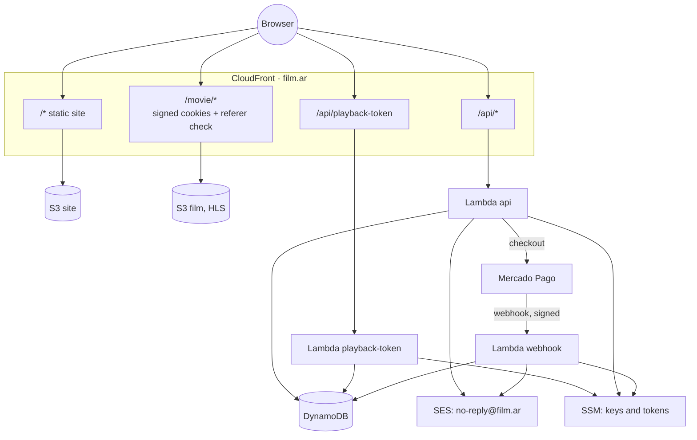

# serverless-vod


A pay-per-view streaming site for one film, fully serverless on AWS and built in
Terraform. It runs in production at **[film.ar](https://film.ar)**, selling
*El florecer de un bombisto* (dir. Nico Stefanazzi).

A buyer pays with Mercado Pago, gets a sign-in link by email and watches the film in
the browser. No accounts or passwords, no servers to keep running, and the monthly bill
is under a dollar when nobody is buying.

## How it works



Everything sits behind one CloudFront distribution and one domain, routed by path, so
the browser never deals with CORS. Both buckets and the two internal Lambdas are private
and only reachable through CloudFront (Origin Access Control). The webhook is the one
public endpoint, and it rejects anything without a valid Mercado Pago signature.

**Buying.** `POST /api/checkout` creates an order and a Mercado Pago Checkout Pro
preference. When the payment is approved, Mercado Pago calls the webhook. The webhook
checks the HMAC signature, fetches the payment from Mercado Pago's API and checks the
amount and currency against the order. Only then does it create the user, grant the
film and email a sign-in link. Refunds, cancellations and chargebacks revoke access.
Someone who already owns the film gets a sign-in link from checkout instead of a second
charge.

**Signing in.** Magic links, valid for 15 minutes and single use. The link opens a page
that asks the user to confirm before the token is consumed, because corporate mail
scanners open every link they see and would otherwise burn it.

**Watching.** The player asks `/api/playback-token` for access. That Lambda checks the
session and the purchase, then returns CloudFront signed cookies that are valid for 5
minutes and bound to the viewer's IP. The player renews them every 4 minutes while
playing. On top of that:

- up to 3 devices per purchase, and one device playing at a time. Pausing or closing
  the tab frees the slot right away;
- a device can switch networks, but alternating between IPs is limited, to stop a
  shared account taking turns;
- a CloudFront Function rejects `/movie/*` requests whose `Referer` isn't the site
  itself.

**The film.** `aws/media/make-media.sh` encodes the master to HLS with ffmpeg: 1080p,
720p, 480p and 360p, 2-second keyframes and no upscaling. Subtitles go in as WebVTT
tracks with the `X-TIMESTAMP-MAP` that `.ts` segments need. The player is hls.js, with
a quality menu and subtitles in 5 languages.

## Things worth pointing out

- **No secrets in Terraform state.** The CloudFront signing key and the Mercado Pago
  credentials are written to SSM Parameter Store by scripts or by hand. Terraform only
  reads the public key, and the Lambdas fetch the secrets at runtime. The signing key
  rotates with a script, and the key resources are keyed by fingerprint so a rotation
  is a create and then a delete, not a replace in place.
- **Two AWS accounts, one codebase.** A dev account and the client's account are
  Terraform workspaces with their own state bucket. Per-account settings (domain, price,
  alert email, limits) live in one map in `settings.tf`.
- **The domain switch has two stages.** Setting `domain` creates the Route 53 zone, the
  certificate and the SES records. Only once the registrar delegates to the zone does
  `serve_on_domain` move the site, the email links and the sender to the domain. After
  that, the old `*.cloudfront.net` address redirects to it with the path intact.
- **Cost and abuse limits.** Each Lambda has reserved concurrency, so a flood can't
  scale it, or the bill, without bound. An AWS Budget and CloudWatch alarms (Lambda
  errors, webhook rejections, SES bounce and complaint rates) report to email.
  In production, the tables holding users, orders and purchases have deletion
  protection and point-in-time recovery.
- **Headers.** CSP, HSTS, `X-Frame-Options: DENY` and `nosniff` through a CloudFront
  response headers policy.

## layout

```
aws/
├── terraform/              # the whole stack
│   ├── cloudfront.tf       # distribution, behaviors, security headers
│   ├── domain.tf           # Route 53, ACM, SES domain, mail records
│   ├── lambda*.tf          # the three Lambdas and their IAM
│   ├── dynamodb.tf         # orders, users, entitlements, sessions, devices…
│   ├── monitoring.tf       # alarms, budget, log retention
│   ├── settings.tf         # per-workspace settings
│   ├── lambda/             # Lambda code (Node.js, AWS SDK only)
│   ├── cloudfront-function/
│   ├── rotate-signing-key.sh
│   ├── seed-content.sh     # uploads site and film, sets cache headers
│   └── verify.sh           # end-to-end check against the dev account
├── terraform-bootstrap/    # state bucket per account
├── site/                   # static site, plain HTML/CSS/JS
└── media/                  # ffmpeg scripts: HLS ladder, subtitles, landing loop
```

## Running it

```sh
cd aws/terraform-bootstrap && terraform apply      # once per account: state bucket
cd ../terraform
terraform init -backend-config="bucket=serverless-vod-tfstate-<ACCOUNT_ID>"
./rotate-signing-key.sh                             # signing key pair into SSM
terraform apply
../media/make-media.sh                              # encode the film into aws/media/movie
./seed-content.sh                                   # upload site and film
./verify.sh                                         # dev only: checks the whole flow
```

The Mercado Pago access token and webhook secret go into SSM by hand
(`/serverless-vod/mp-access-token`, `/serverless-vod/mp-webhook-secret`).

## Cost

With little traffic it is cents a month: the Route 53 zone is US$0.50, and S3,
DynamoDB on demand, Lambda and SES barely register. The main variable cost is
CloudFront data transfer: a full viewing at 1080p is about 0.8 GB, around US$0.07.
